<p align="center">
  
</p>

<h1 align="center">WinCleaner</h1>

<p align="center"><a href="README.md">English</a> · <b>Español</b></p>

<p align="center">
  <b>Limpia, ordena y pone a punto Windows. Sin anuncios, sin telemetría y sin instalador.</b><br>
  Lo que hacen CCleaner y Revo Uninstaller, en una sola app ligera, bonita y de código abierto.
</p>

<p align="center">
  <a href="../../releases/latest"></a>
  <a href="../../actions/workflows/ci.yml"></a>
  
  <a href="LICENSE"></a>
</p>

<p align="center">
  <picture>
    <source media="(prefers-color-scheme: dark)" srcset="docs/images/hero-oscuro.png">
    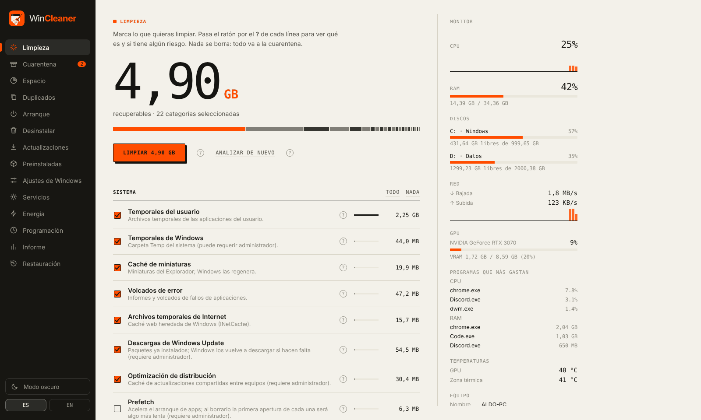
  </picture>
</p>

## Por qué WinCleaner

- **Nada se borra a la primera.** Todo lo que limpias va a una **cuarentena** y se puede devolver a su sitio con un clic. Solo se borra de verdad cuando tú vacías la cuarentena.
- **Siempre ves antes lo que va a pasar.** Primero analiza, luego te enseña cuánto ocupa cada cosa y tú decides qué marcar.
- **Cada opción explica su riesgo.** Pasa el ratón por el **?** de cualquier línea: te dice qué es, qué pasa si lo quitas y si es *sin riesgo*, *reversible* o *con cuidado*.
- **Todo cambio en Windows tiene «Deshacer».** Ajustes, servicios, arranque y aplicaciones se pueden revertir, y la app ofrece crear un **punto de restauración** antes de tocar nada importante.
- **Sin anuncios, sin cuentas y sin telemetría.** No envía datos a ningún sitio. El historial se queda en tu equipo y solo guarda cifras y fechas, nunca nombres de archivos.
- **Portable y ligero.** Un único `.exe`, sin instalador ni servicios en segundo plano. Usa el WebView2 que ya trae Windows.
- **Claro u oscuro, en español o en inglés.** Sigue el tema del sistema y puedes cambiarlo desde la barra lateral.

## Qué puede hacer

### Limpieza

Temporales de usuario y de Windows, miniaturas, volcados de error, descargas de Windows Update, Prefetch, cachés de **Chrome, Edge, Firefox, Brave, Opera y Vivaldi**, cachés de apps (Discord, Slack, Spotify, Steam, Epic, Office, Microsoft Store...), de gráficos (DirectX, NVIDIA) y de desarrollo (npm, pip, NuGet, cargo, Gradle, VS Code). También vacía la **Papelera de reciclaje**.

Las reglas son declarativas ([`windows.toml`](crates/core/rules/windows.toml)): las seguras vienen marcadas y las delicadas, desmarcadas y explicadas.

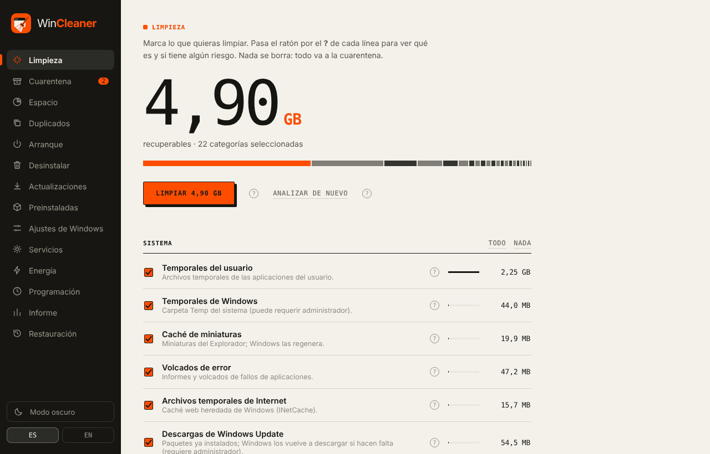

### Cuarentena

Cada limpieza queda guardada como un lote con su fecha, número de archivos y tamaño. Puedes **restaurarlo** entero o **borrarlo** definitivamente. Después de limpiar aparece un aviso con «Deshacer».

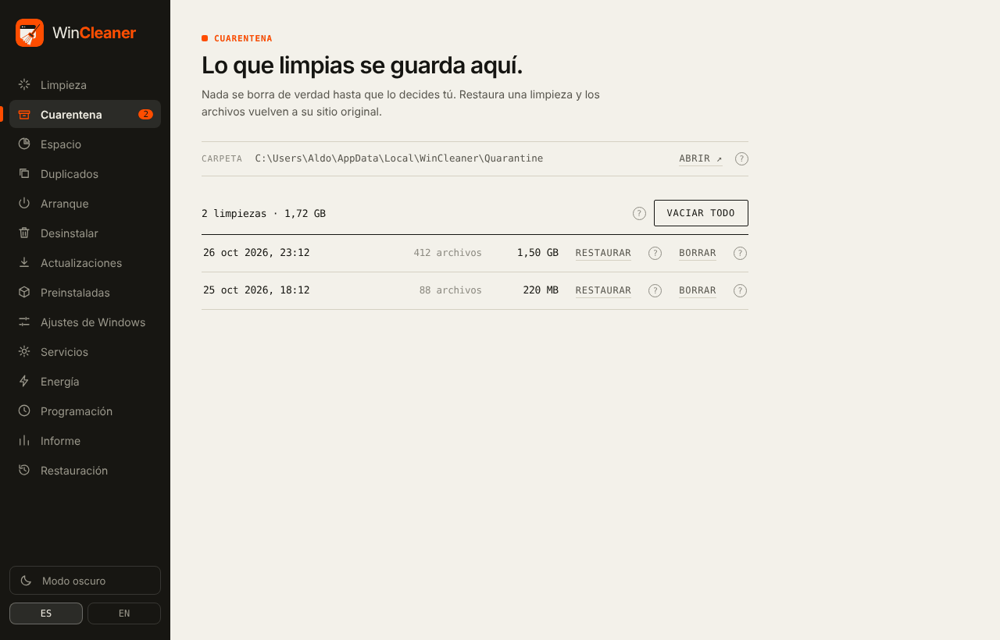

### Espacio en disco

Mapa de bloques (treemap) de tu carpeta o de cualquier disco: haz clic para entrar en una carpeta y mira los **archivos más grandes**. Lo que marques va a la cuarentena; las carpetas del sistema están protegidas y no se pueden seleccionar.

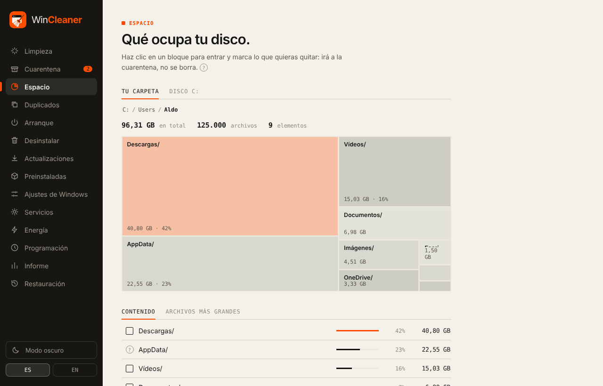

### Duplicados y archivos grandes o antiguos

Busca archivos idénticos **por contenido**, no por nombre, en Descargas, Documentos, Escritorio, Imágenes, Vídeos y Música. Eliges qué copia se queda y el resto va a la cuarentena. La pestaña *Grandes y antiguos* encuentra lo que pesa mucho y no tocas desde hace meses.

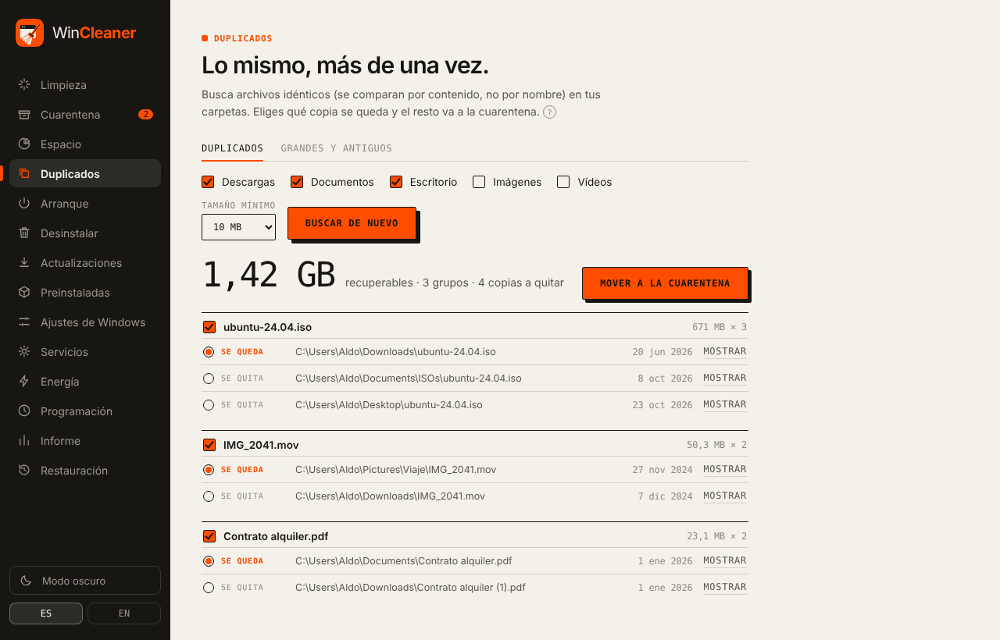

### Arranque

Lo que se inicia con Windows (registro del usuario, del sistema y carpeta Inicio). Desactivar no desinstala nada y se puede volver a activar cuando quieras.

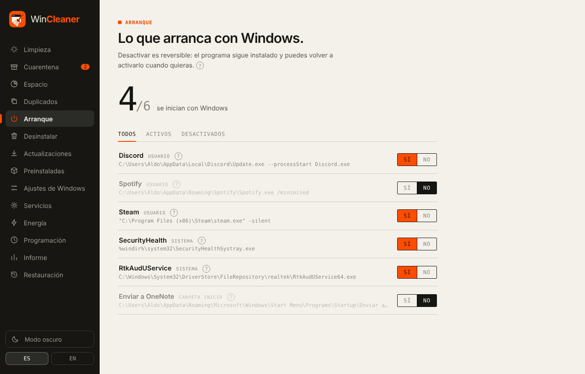

### Desinstalar sin dejar rastro

Lista de programas con icono, fecha de instalación, **último uso** y tamaño, con buscador y orden por columnas. Usa el desinstalador oficial de cada programa y después busca **restos**: tú revisas qué quitar, las carpetas van a la cuarentena y las claves del registro se guardan antes en una copia `.reg` que puedes restaurar.

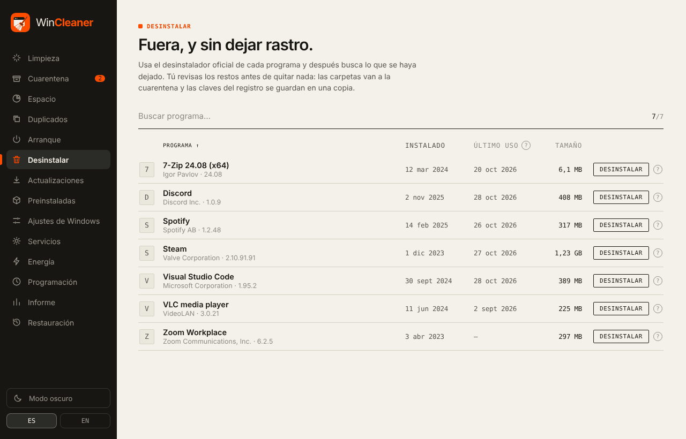

### Actualizaciones

Busca versiones nuevas de tus programas con **winget**, el gestor oficial de Windows, y las instala por ti.

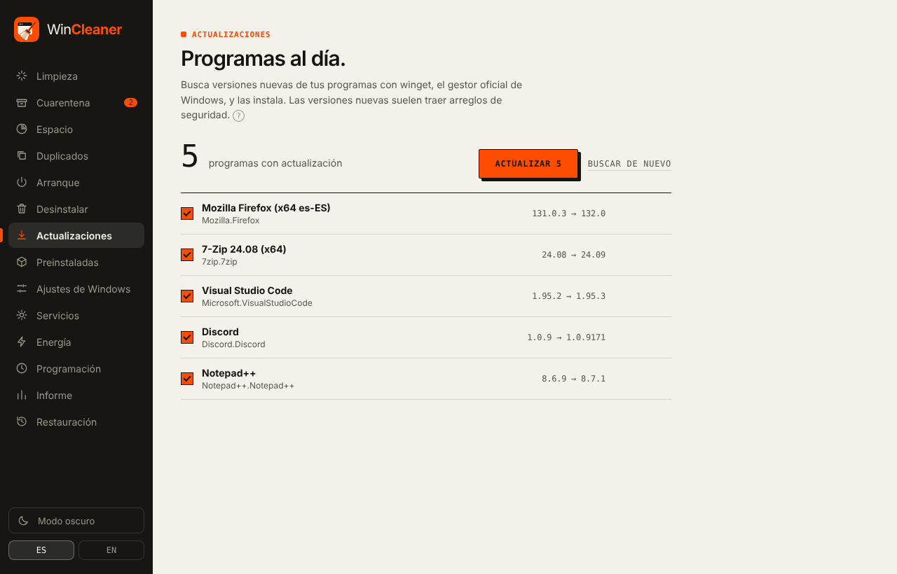

### Aplicaciones preinstaladas (debloat)

Quita las apps que vienen con Windows o con tu equipo y que no pediste (Noticias, El Tiempo, Bing, Sugerencias...). Solo aparecen las que tienes instaladas, cada una explica qué pasa si la quitas, y todas se pueden volver a instalar desde Microsoft Store. Nunca toca componentes de los que depende Windows.

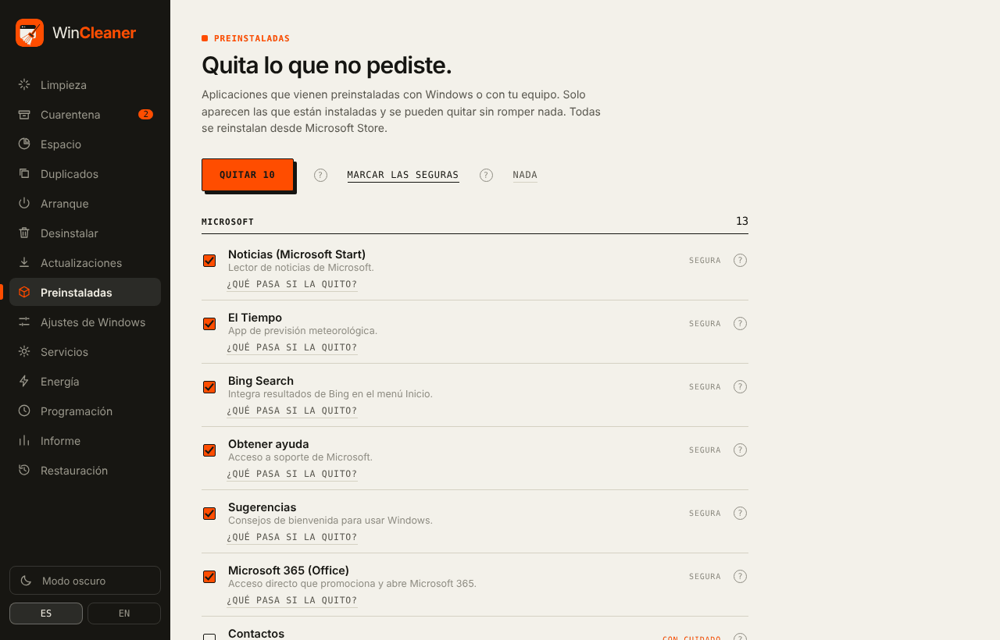

### Ajustes de Windows

Cambios opcionales de **privacidad, rendimiento e interfaz** (historial de actividad, identificador de publicidad, telemetría al mínimo, Copilot, búsqueda web en Inicio, transparencias, extensiones de archivo...). Solo tocan el registro y cada uno tiene su «Deshacer».

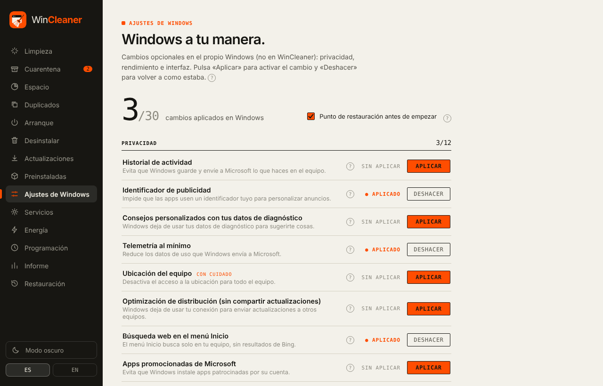

### Servicios

Pasa a **Manual** servicios que casi nadie necesita que arranquen solos (telemetría, SysMain, mapas, Xbox...). No se borran ni se detienen: Windows los inicia si hacen falta, y «Deshacer» devuelve el inicio original.

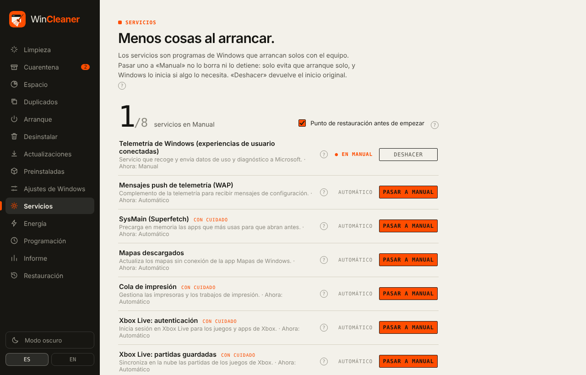

### Energía

Cambia el plan de energía de Windows en un clic y añade el plan **Máximo rendimiento** si tu equipo no lo muestra.

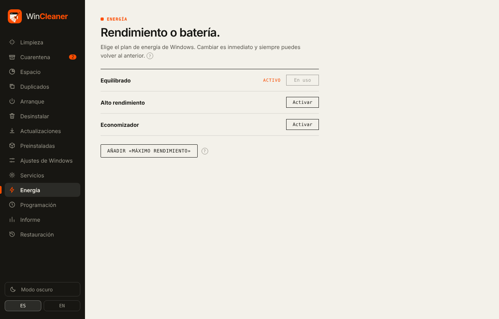

### Programación

Una limpieza segura cada día, semana o mes a la hora que elijas, sin abrir ventana y con aviso al terminar. Puede limpiar o **solo avisar**, y vaciar sola los lotes antiguos de la cuarentena. Usa el Programador de tareas de Windows: nada se queda residente en memoria.

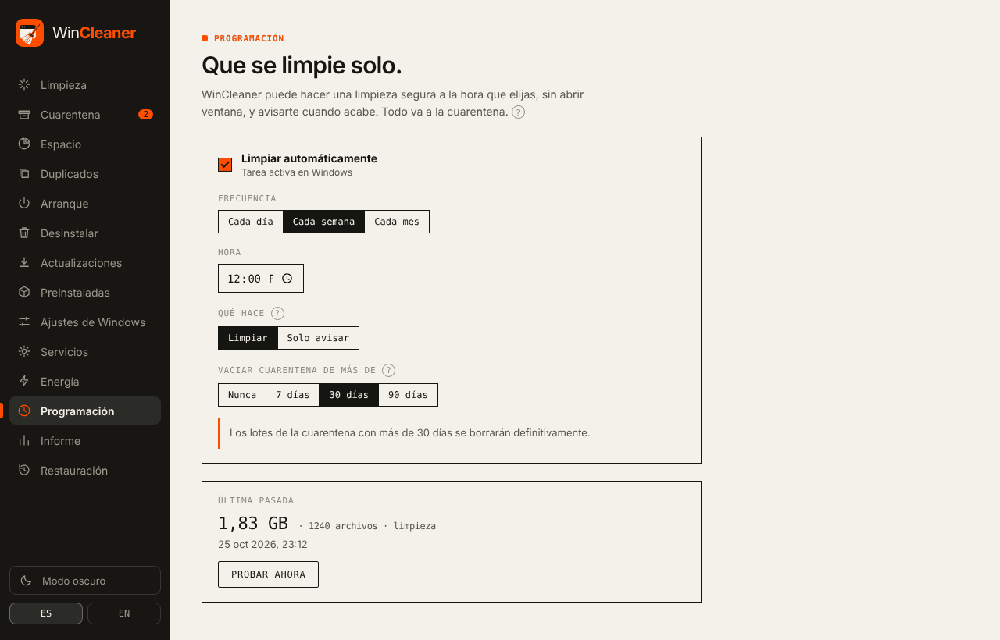

### Informe

Cuánto llevas liberado, una gráfica de los últimos 30 días y los últimos movimientos.

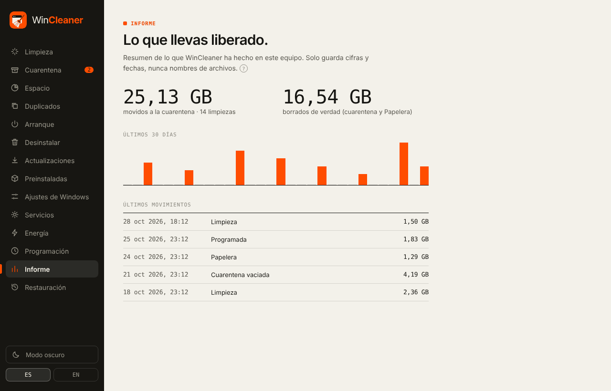

### Puntos de restauración

Crea un punto de restauración cuando quieras (y la app lo ofrece antes de desinstalar, quitar aplicaciones o cambiar ajustes). Si algo va mal, abre *Restaurar sistema* de Windows desde aquí. Si hace falta, reinicia WinCleaner como administrador.

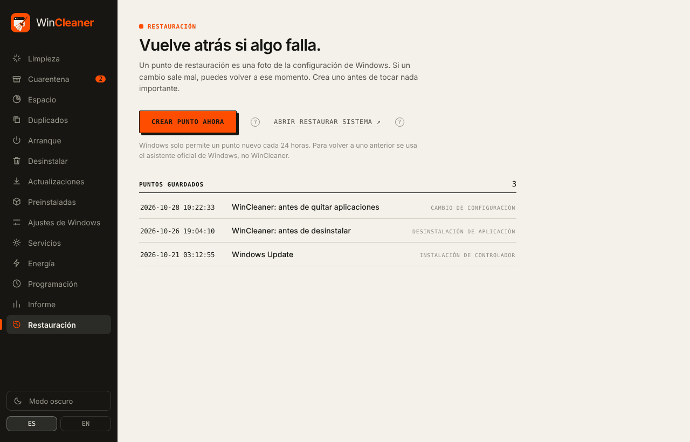

### Monitor del equipo

Con la ventana ancha aparece un panel lateral con **CPU, RAM, discos, red en vivo, GPU NVIDIA, temperaturas, los programas que más gastan, salud de los discos** y las especificaciones del equipo. Con la ventana estrecha se oculta y deja de consultar nada.

### Ayuda en cada opción

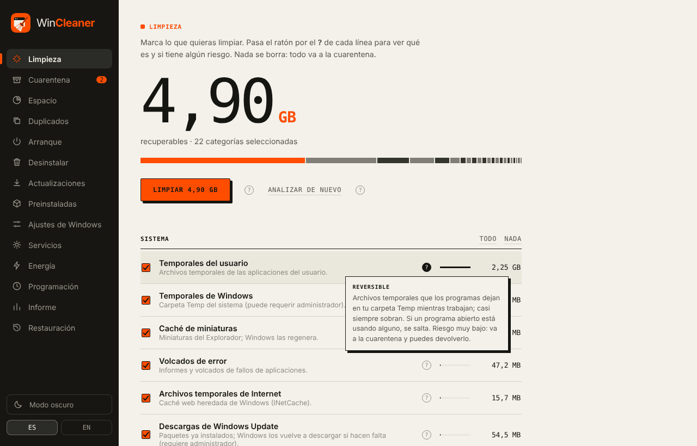

## Descargar y usar

1. Descarga `WinCleaner-vX.Y.Z-portable.exe` de la [última versión](../../releases/latest).
2. Ejecútalo. No se instala: puedes guardarlo donde quieras, incluso en un USB.
3. Algunas funciones (temporales de Windows, servicios, ajustes del sistema, puntos de restauración) necesitan permisos de administrador. La app te avisa y puede reiniciarse como administrador.

Cada versión incluye su **SHA256** para comprobar la descarga:

```powershell
(Get-FileHash .\WinCleaner-v0.1.1-portable.exe).Hash
```

> El ejecutable aún no está firmado, así que Windows SmartScreen puede mostrar «Windows protegió su PC». Pulsa *Más información → Ejecutar de todas formas*. Más detalles en [docs/RELEASING.md](docs/RELEASING.md).

**Requisitos:** Windows 10 u 11 de 64 bits con WebView2 (viene de serie en Windows 11 y en Windows 10 actualizado).

## Lo que no hace (a propósito)

- **No limpia el registro a lo bruto.** Da muy poco beneficio y puede romper cosas. Solo se tocan claves concretas: las de los ajustes reversibles y los restos de un programa que acabas de desinstalar, con copia previa.
- **No «optimiza» la RAM.** Vaciar la memoria a la fuerza hace que el equipo vaya más lento después.
- **No es un antivirus** ni se queda residente vigilando nada.

## Para desarrolladores

**Stack:** [Tauri 2](https://tauri.app) + Rust (núcleo en [`crates/core`](crates/core), sin dependencias de la interfaz) + Svelte 5 ([`ui`](ui)).
Los catálogos son archivos TOML en [`crates/core/rules`](crates/core/rules): limpieza, aplicaciones preinstaladas, ajustes y servicios. Toda regla nueva necesita su texto de ayuda.

```bash
npm install --prefix ui
cargo test -p wincleaner-core     # funciona en cualquier sistema
cargo tauri dev                   # requiere Windows + WebView2 (cargo install tauri-cli)
```

El CI compila en Windows y deja el ejecutable portable como artefacto (`WinCleaner-portable`) en cada cambio de `main`. Para publicar una versión con su SHA256 y, opcionalmente, firmarla: [docs/RELEASING.md](docs/RELEASING.md). Plan y fases del proyecto: [docs/PLAN.md](docs/PLAN.md).

Para traducir: los textos de la interfaz están en español en el código (`t('texto')`) y la traducción inglesa vive en [`ui/src/en.js`](ui/src/en.js).

`.claude/settings.json` activa las suites architecture, product-discovery, quality-assurance e implementation de [levnikolaevich/claude-code-skills](https://github.com/levnikolaevich/claude-code-skills).

## Licencia

[MIT](LICENSE). Úsalo, cámbialo y compártelo.

<sub>Las capturas usan datos de ejemplo.</sub>
