<p align="center">
  
</p>

<h1 align="center">WinCleaner</h1>

<p align="center"><b>English</b> · <a href="README.es.md">Español</a></p>

<p align="center">
  A Windows cleaner and uninstaller with no ads and no telemetry. It runs as a single portable .exe.<br>
  It covers most of what people use CCleaner and Revo Uninstaller for, and the code is open under the MIT license.
</p>

<p align="center">
  <a href="../../releases/latest"></a>
  <a href="../../actions/workflows/ci.yml"></a>
  
  <a href="LICENSE"></a>
</p>

<p align="center">
  <picture>
    <source media="(prefers-color-scheme: dark)" srcset="docs/images/en/hero-dark.png">
    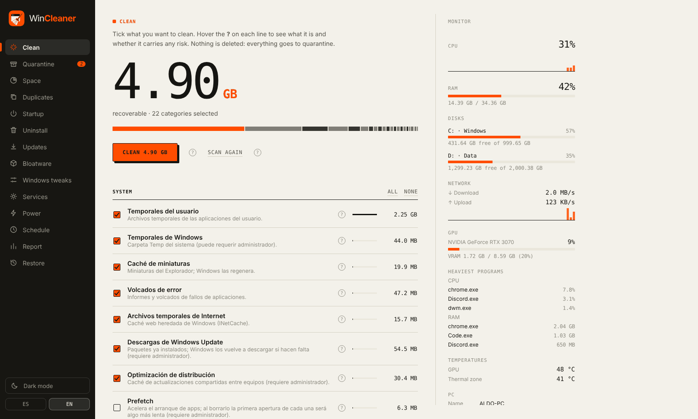
  </picture>
</p>

## How it keeps your PC safe

When you clean, files go to a quarantine folder first. You can put any cleanup back where it was, and files are only deleted for good when you empty the quarantine yourself.

The cleaning screens scan first and show the size of each item, and you pick what goes. Each option has a **?** next to it. Hover it to read what the item is, what happens if you remove it, and how risky that is.

Changes to Windows itself (tweaks, services, startup entries, removed apps) can be undone from the same screen. Before the bigger ones, the app offers to create a Windows restore point.

WinCleaner has no account and sends nothing over the network. Its usage history stays on your PC and holds only sizes and dates, never file names. There is no installer and nothing runs in the background. The window uses the WebView2 runtime that Windows already includes.

The interface comes in light and dark themes and in English and Spanish. Some texts are still Spanish only in the English version: the names and descriptions of cleaning rules, tweaks, services and bloatware, and the **?** help notes.

## Features

### Clean

Cleans user and Windows temp files, thumbnails, crash dumps, Windows Update downloads and Prefetch. It also clears the caches of Chrome, Edge, Firefox, Brave, Opera and Vivaldi, of apps like Discord, Slack, Spotify, Steam, Epic Games, Office and the Microsoft Store, of DirectX and NVIDIA shaders, and of developer tools (npm, pip, NuGet, cargo, Gradle, VS Code). It can empty the Recycle Bin too.

The rules live in a plain TOML file, [`windows.toml`](crates/core/rules/windows.toml). Safe rules start ticked. The rest start unticked, with a note on what they cost you.

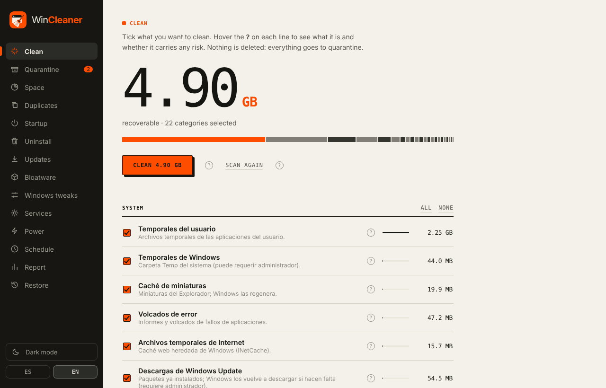

### Quarantine

Each cleanup is saved as a batch with its date, file count and size. You can restore a batch or delete it permanently. Right after a cleanup, a notice with an Undo button appears.

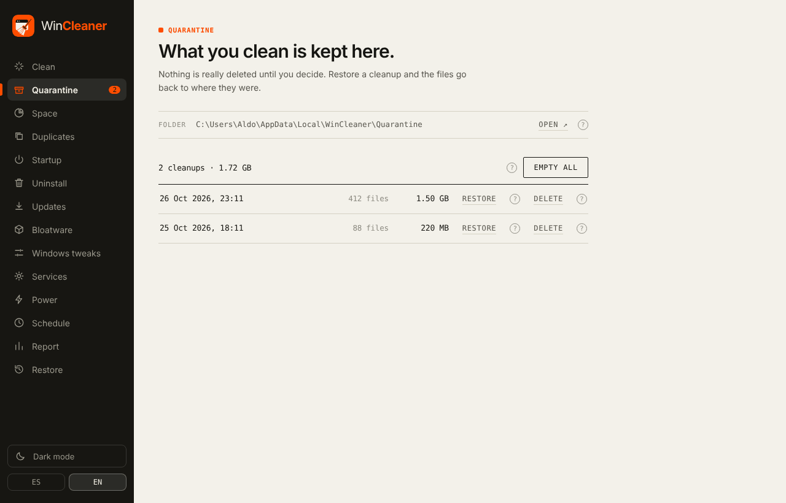

### Disk space

A treemap of your user folder or of a whole drive. Click a block to open that folder, or switch to the list of the largest files. Anything you tick goes to quarantine. System folders are protected and can't be ticked.

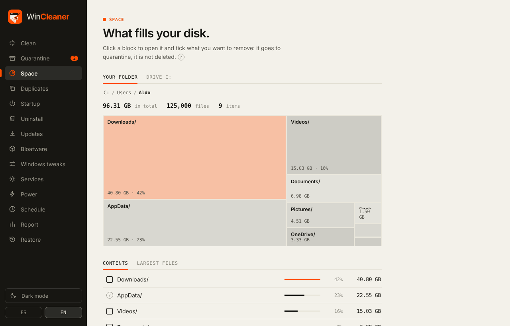

### Duplicates and large old files

Finds identical files by comparing their content, so renamed copies count too. It searches Downloads, Documents, Desktop, Pictures, Videos and Music. For each group you choose the copy to keep, and the others go to quarantine. The second tab lists big files you haven't touched in months.

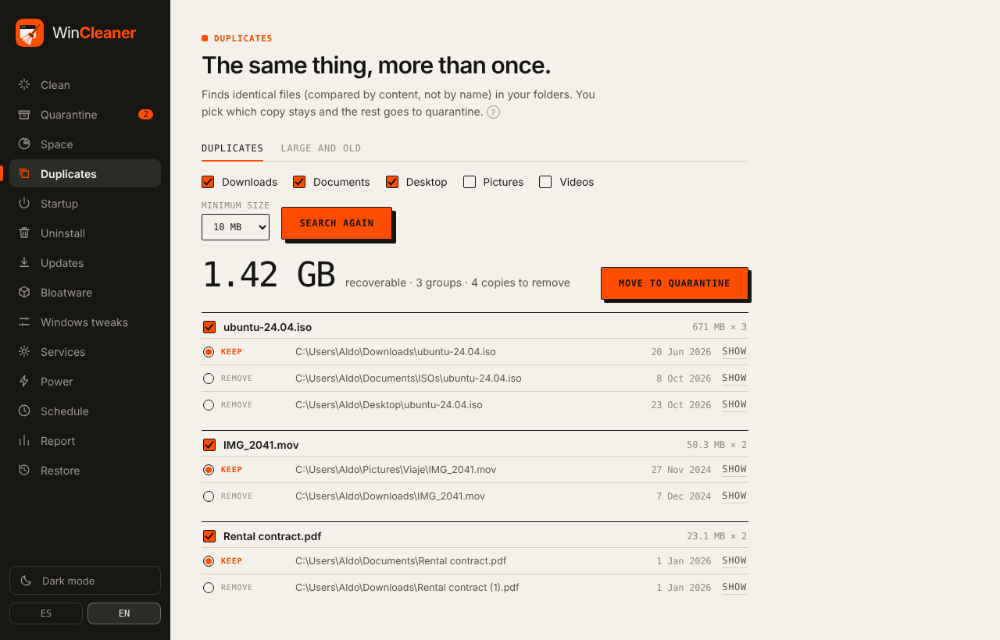

### Startup

Lists what starts with Windows from the user and system registry keys and from the Startup folder. Turning an entry off leaves the program installed, and you can turn it back on at any time.

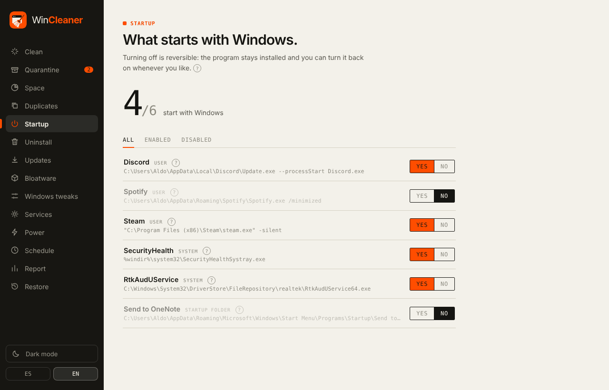

### Uninstall

Lists your programs with their icon, install date, last use and size. You can search and sort by any column. WinCleaner runs each program's own uninstaller and then looks for leftovers. You review what it found before anything is removed: folders go to quarantine, and registry keys are exported to a `.reg` backup first so you can restore them.

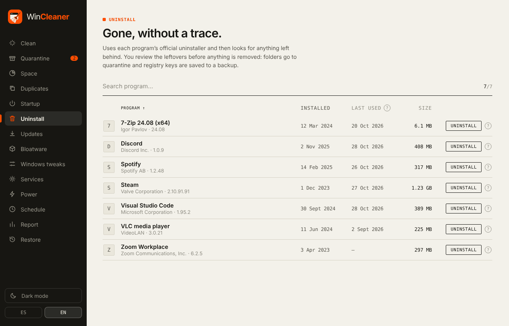

### Updates

Checks your programs for new versions with winget, the Windows package manager, and installs the ones you pick.

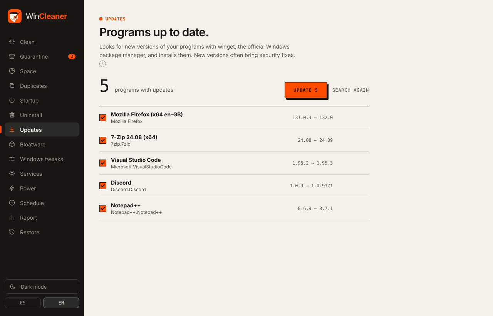

### Bloatware

Removes apps that came with Windows or with your PC, such as News, Weather, Bing Search or Tips. The list shows only apps you have installed, and each one says what you lose by removing it. All of them can be reinstalled from the Microsoft Store. The catalog leaves out anything Windows depends on.

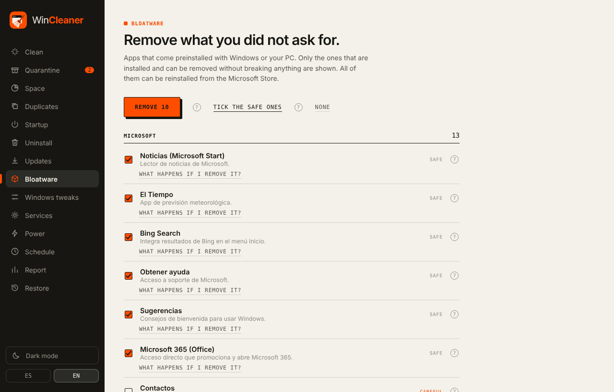

### Windows tweaks

Optional privacy, performance and interface changes: activity history, the advertising ID, minimum telemetry, Copilot, web results in Start search, transparency effects, file extensions and more. They only touch the registry, and each one has an Undo button.

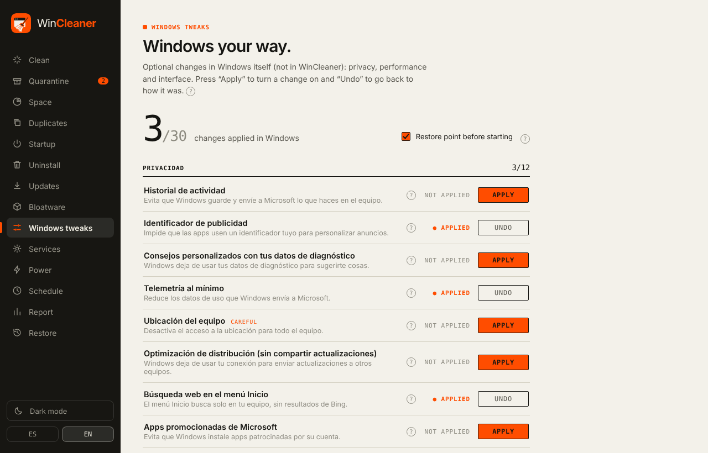

### Services

Sets services that few people need at boot to Manual. The list includes telemetry, SysMain, Downloaded Maps and the Xbox services. A Manual service is still there and Windows starts it when something needs it. Undo restores the original startup type.

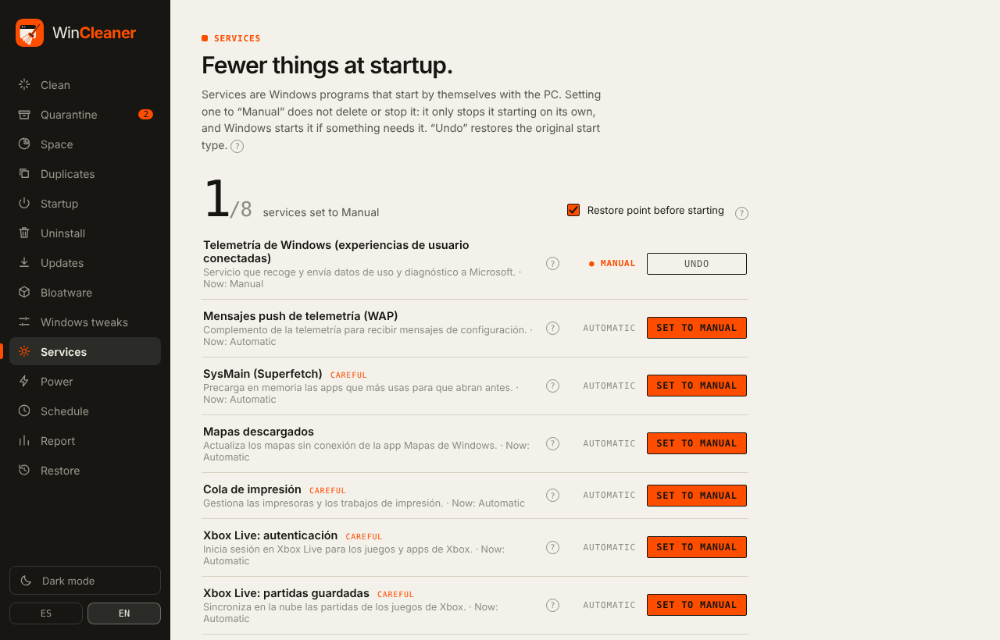

### Power

Switches the Windows power plan in one click. If your PC doesn't show the Ultimate Performance plan, it can add it.

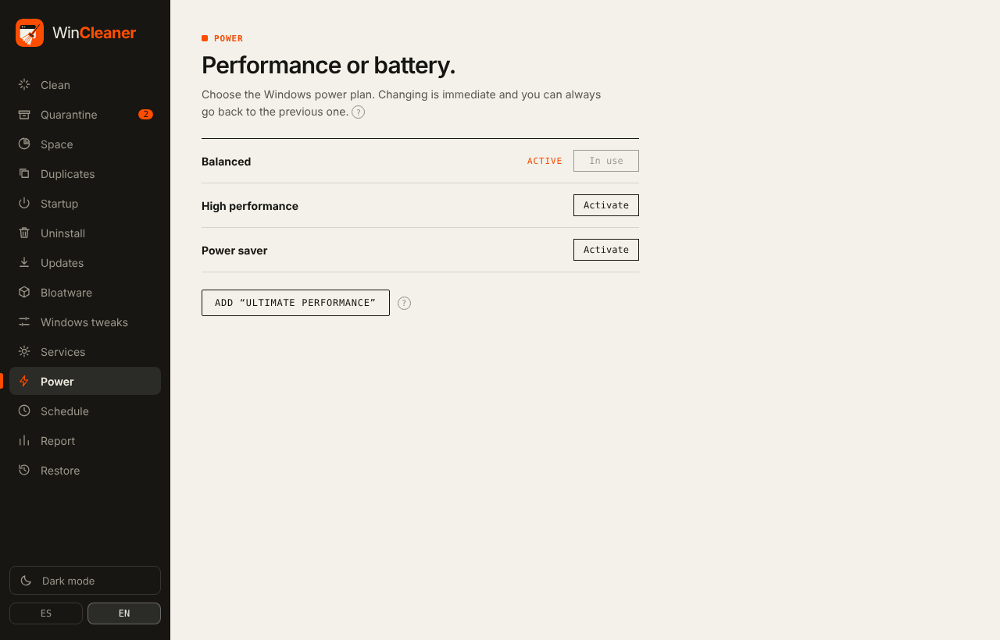

### Schedule

Runs a safe cleanup every day, week or month at the time you choose, without opening the window, and shows a notification when it's done. It can clean or only tell you how much space you could free, and it can empty old quarantine batches as well. It uses the Windows Task Scheduler, so nothing stays in memory between runs.

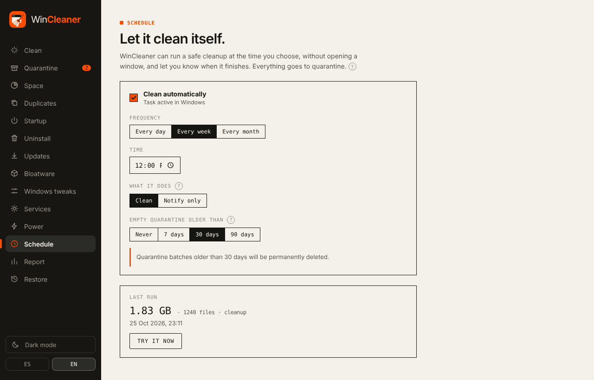

### Report

How much you've freed so far, a chart of the last 30 days and a list of recent cleanups.

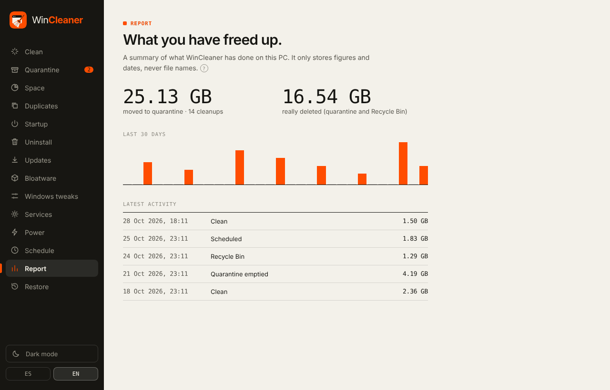

### Restore points

Create a restore point whenever you like. The app also offers one before uninstalling programs, removing apps or applying tweaks. If something goes wrong, this screen opens Windows System Restore. When an action needs administrator rights, WinCleaner can restart itself as administrator.

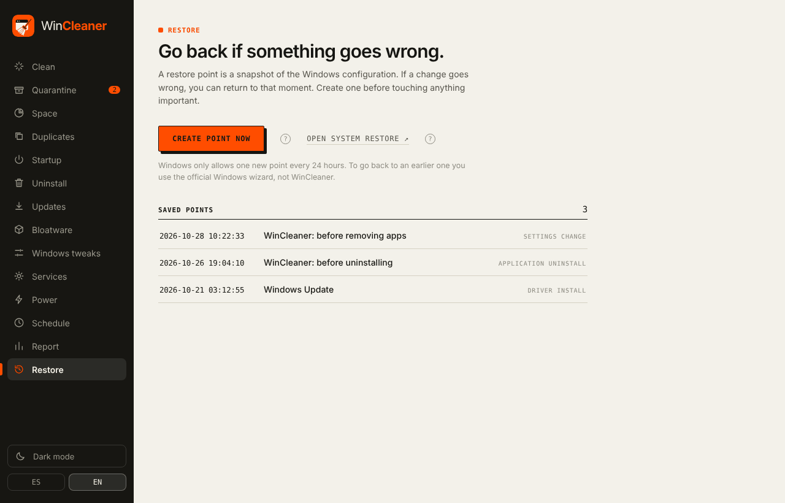

### System monitor

On a wide window, a side panel shows CPU, RAM, disks, live network speed, NVIDIA GPU usage, temperatures, the programs using the most CPU and memory, disk health and your PC's specs. On a narrow window the panel hides and stops polling.

### Help on every option

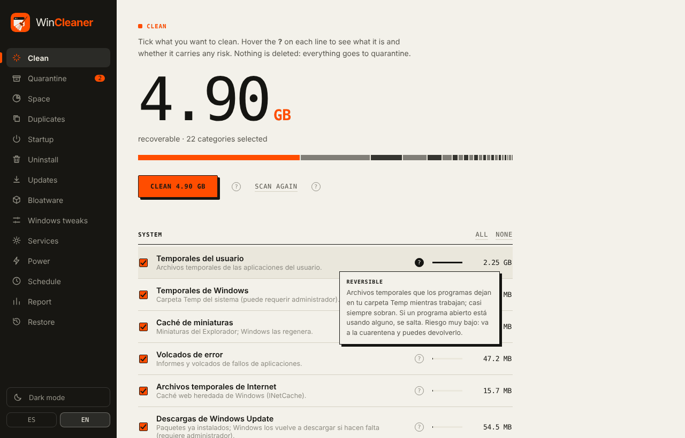

## Download

1. Download `WinCleaner-vX.Y.Z-portable.exe` from the [latest release](../../releases/latest).
2. Run it. There's nothing to install, so you can keep it in any folder or on a USB stick.
3. Some features need administrator rights: the Windows temp folder, services, system tweaks and restore points. The app tells you when, and can restart itself as administrator.

Each release lists the file's SHA256 so you can check your download:

```powershell
(Get-FileHash .\WinCleaner-v0.1.1-portable.exe).Hash
```

The .exe isn't code-signed yet, so Windows SmartScreen may say "Windows protected your PC". Click *More info*, then *Run anyway*. See [docs/RELEASING.md](docs/RELEASING.md) for the signing plan.

You need 64-bit Windows 10 or 11 with WebView2, which ships with Windows 11 and with up-to-date Windows 10.

## What it leaves out on purpose

WinCleaner has no general registry cleaner. Those give almost no speed-up and can break things. It only edits specific keys: the ones behind each reversible tweak, and the leftovers of a program you just uninstalled, after backing them up.

It has no RAM "optimizer" either. Forcing memory to empty makes Windows slower afterwards, because it has to load everything again.

It isn't an antivirus, and it doesn't stay running in the background.

## For developers

WinCleaner is built with [Tauri 2](https://tauri.app). The Rust core in [`crates/core`](crates/core) has no UI code, and the interface is Svelte 5 in [`ui`](ui). The catalogs for cleaning rules, bloatware, tweaks and services are TOML files in [`crates/core/rules`](crates/core/rules). Every new entry needs a help text.

```bash
npm install --prefix ui
cargo test -p wincleaner-core     # runs on any OS
cargo tauri dev                   # needs Windows + WebView2 (cargo install tauri-cli)
```

CI builds on Windows and uploads the portable .exe as the `WinCleaner-portable` artifact for every change to `main`. [docs/RELEASING.md](docs/RELEASING.md) explains how to publish a release with its SHA256 and how to sign it. The project plan is in [docs/PLAN.md](docs/PLAN.md) (Spanish).

UI strings are written in Spanish in the code as `t('texto')`, and the English translations are in [`ui/src/en.js`](ui/src/en.js).

`.claude/settings.json` turns on the architecture, product-discovery, quality-assurance and implementation suites from [levnikolaevich/claude-code-skills](https://github.com/levnikolaevich/claude-code-skills).

## License

[MIT](LICENSE).

<sub>Screenshots use sample data.</sub>
